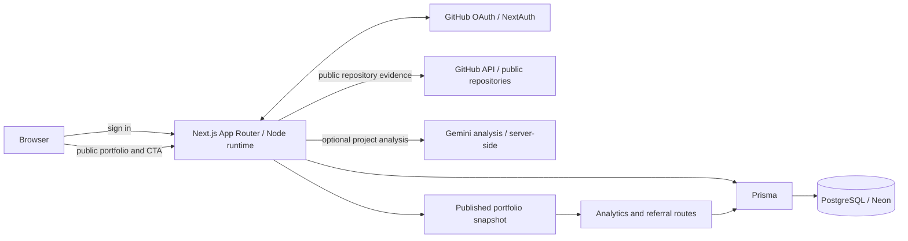

# Architecture

SkillLoop is a Next.js App Router application running on the Node.js runtime. NextAuth handles GitHub OAuth. The server uses the linked GitHub identity to import public repositories and supporting public repository evidence. Gemini can produce a structured project analysis when configured; if unavailable, a metadata-based fallback is used. Owners can edit and approve descriptions before selecting projects for publication.

Prisma connects to the application's PostgreSQL database (Neon in the hosted environment). It stores accounts, project evidence, portfolio drafts, immutable published snapshots, analytics events, and referral conversions. OAuth credentials, provider tokens, AI keys, and database access stay server-side. Public portfolio pages read published snapshots; private preview and editing require authentication.

Analytics records pseudonymous browser-day views and CTA clicks. Referral attribution uses an HttpOnly, signed, expiring cookie; only a genuinely new GitHub account with a matching linked account can be attributed. A database uniqueness constraint makes conversion recording idempotent. Analytics and referral tracking failures do not interrupt authentication or public page rendering.

Production application: <https://skillloop-gamma.vercel.app>
Example portfolio: <https://skillloop-gamma.vercel.app/p/drowsei>
Official repository: <https://github.com/HackOnVibeCom/nft9in3fvix72jpu5mto3gqcqmn1h5yvj0fhwqq6>

The production release is reported as commit `c232453`, deployed from a clean Git archive. The organizer deployment workflow remains unchanged. See [RELEASE-CHECKLIST.md](./RELEASE-CHECKLIST.md) for release history and remaining human actions.
