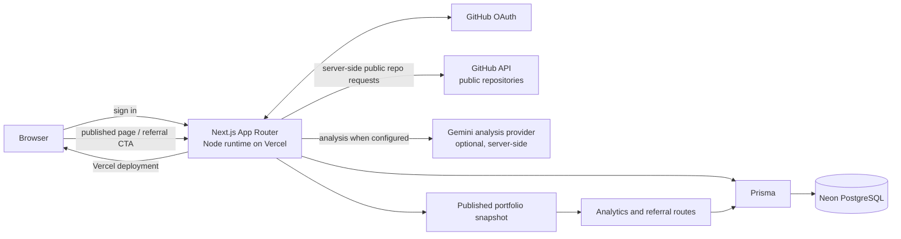

# Architecture

The browser talks to the Next.js application. OAuth credentials, GitHub API access, Gemini keys, and database access remain server-side. Prisma uses the single PostgreSQL database for users, imported project evidence, draft portfolio state, published snapshots, analytics events, and referral conversions. Public portfolio pages read only the published snapshot; private preview is an authenticated workspace route. View and CTA writes are best-effort and use daily pseudonymous keys. Referral cookies are signed and expiry-checked by the application.

The deployed application URL is <https://skillloop-gamma.vercel.app>. The organizer deployment workflow is intentionally left untouched; see [RELEASE-CHECKLIST.md](./RELEASE-CHECKLIST.md) for the documented manual Vercel path.
